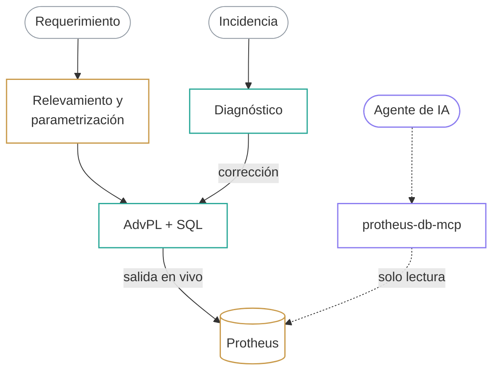

<picture>
  <source media="(prefers-color-scheme: dark)" srcset="assets/portada-oscuro.svg">
  <source media="(prefers-color-scheme: light)" srcset="assets/portada-claro.svg">
  
</picture>

<a href="https://mario-pereyra.github.io"><picture><source media="(prefers-color-scheme: dark)" srcset="assets/boton-portafolio-oscuro.svg"><source media="(prefers-color-scheme: light)" srcset="assets/boton-portafolio-claro.svg"></picture></a>&nbsp;
<a href="https://mario-pereyra.github.io/cv/CV_Mario_Pereyra_Justiniano.pdf"><picture><source media="(prefers-color-scheme: dark)" srcset="assets/boton-cv-oscuro.svg"><source media="(prefers-color-scheme: light)" srcset="assets/boton-cv-claro.svg"></picture></a>&nbsp;
<a href="https://www.linkedin.com/in/mario-pereyra-justiniano-86b205304"><picture><source media="(prefers-color-scheme: dark)" srcset="assets/boton-linkedin-oscuro.svg"><source media="(prefers-color-scheme: light)" srcset="assets/boton-linkedin-claro.svg"></picture></a>&nbsp;
<a href="mailto:mario1w3p.j@gmail.com"><picture><source media="(prefers-color-scheme: dark)" srcset="assets/boton-correo-oscuro.svg"><source media="(prefers-color-scheme: light)" srcset="assets/boton-correo-claro.svg"></picture></a>

Desarrollador y estudiante de 7.º semestre de Ingeniería de Sistemas en la Universidad NUR. Desde octubre de 2025 soy consultor TOTVS Protheus en Resultar Soluciones SRL: relevo requerimientos con el cliente, parametrizo el ERP y programo en AdvPL y SQL lo que el estándar no cubre. Fuera del ERP construyo aplicaciones web con TypeScript y herramientas que conectan agentes de IA con datos empresariales.

**Hacia dónde voy:** backend y *Forward Deployed Engineering*. Como consultor ya trabajo junto al cliente: relevo su proceso, lo configuro, acompaño la salida en vivo y corrijo errores. A eso le sumo backend e IA aplicada.

### Qué hago

<picture>
  <source media="(prefers-color-scheme: dark)" srcset="assets/resumen-oscuro.svg">
  <source media="(prefers-color-scheme: light)" srcset="assets/resumen-claro.svg">
  
</picture>

Cifras de código según el historial de git, de enero a octubre de 2026. Sin nombres de clientes, por confidencialidad.

### Del proceso del cliente al código

Arriba llega el trabajo: requerimientos e incidencias. En el medio está lo que hago en Protheus: relevamiento, parametrización de Facturación (SIGAFAT) y código en AdvPL y SQL. A la derecha, un agente de IA consulta esa misma base con protheus-db-mcp, en solo lectura.

### Proyectos

<picture>
  <source media="(prefers-color-scheme: dark)" srcset="assets/figura-oscuro.svg">
  <source media="(prefers-color-scheme: light)" srcset="assets/figura-claro.svg">
  
</picture>

**protheus-db-mcp** · servidor MCP en TypeScript · código privado  
Da a agentes de IA (Claude Code, Cursor, Windsurf, Antigravity) consultas de solo lectura sobre bases de Protheus en SQL Server, PostgreSQL y Oracle. Expone 5 herramientas: listar perfiles sin mostrar credenciales, probar la conexión, ejecutar una consulta, describir una tabla con el diccionario SX3 y listar tablas. Tiene 8 archivos de prueba.

<a href="https://vintage.marioelprogamer710.workers.dev"><picture><source media="(prefers-color-scheme: dark)" srcset="assets/proyecto-vintage-oscuro.svg"><source media="(prefers-color-scheme: light)" srcset="assets/proyecto-vintage-claro.svg"></picture></a><a href="https://quinela-mundialera-frontend.vercel.app"><picture><source media="(prefers-color-scheme: dark)" srcset="assets/proyecto-quiniela-oscuro.svg"><source media="(prefers-color-scheme: light)" srcset="assets/proyecto-quiniela-claro.svg"></picture></a><a href="https://github.com/Mario-pereyra/practico4"><picture><source media="(prefers-color-scheme: dark)" srcset="assets/proyecto-cine-oscuro.svg"><source media="(prefers-color-scheme: light)" srcset="assets/proyecto-cine-claro.svg"></picture></a>

<b>Vintage Secret’s:</b> <a href="https://vintage.marioelprogamer710.workers.dev">demo</a> · <a href="https://github.com/Mario-pereyra/vintage">código</a> &nbsp;&nbsp; <b>Quiniela:</b> <a href="https://quinela-mundialera-frontend.vercel.app">demo</a> · <a href="https://github.com/PabloArauzCaballero/QuinelaMundialeraBackend">backend</a> · <a href="https://github.com/PabloArauzCaballero/QuinelaMundialeraFrontend">frontend</a> &nbsp;&nbsp; <b>Cine Reservas:</b> <a href="https://github.com/Mario-pereyra/practico4">código</a>

<picture><source media="(prefers-color-scheme: dark)" srcset="assets/desplegable-proyectos-oscuro.svg"><source media="(prefers-color-scheme: light)" srcset="assets/desplegable-proyectos-claro.svg"></picture>

- **Módulo de Contabilidad de Flowy ERP** · universidad, equipo de 4 · [repo](https://github.com/MarcoMelgar10/Modulo_activo_fijos)  
  Mi aporte, con la cuenta `Mario1w3`: el dashboard fiscal y los libros de Compras y Ventas (+1.176 líneas), sus pruebas, la preparación para el despliegue y la documentación de endpoints. Express, Sequelize, MySQL, Redis, React, Jest y Docker.
- **Impulsame** · plataforma de crowdfunding · [repo](https://github.com/Mario-pereyra/Proyecto_Final_Web_02-2025)  
  Node.js, Express, PostgreSQL, Docker y pasarela de pagos. 87 commits.
- **AstroMarket** · marketplace de tecnología · [repo](https://github.com/Mario-pereyra/Proyecto-final-Web)  
  Node.js, Express y MySQL. 41 commits.
- **CLI de SQL de solo lectura** · `cli-msql-personalizada` · código privado  
  CLI en Python sobre `go-sqlcmd`, con control de solo lectura y varios clientes; CI, release v1.2.0 y 10 archivos de prueba. Es el antecesor de protheus-db-mcp.

### Stack

<picture>
  <source media="(prefers-color-scheme: dark)" srcset="assets/stack-oscuro.svg">
  <source media="(prefers-color-scheme: light)" srcset="assets/stack-claro.svg">
  
</picture>

Niveles según mi autoevaluación de octubre de 2026. Los agentes de codificación que uso: Claude Code, Codex, OpenCode y Pi agent.

<picture><source media="(prefers-color-scheme: dark)" srcset="assets/desplegable-experiencia-oscuro.svg"><source media="(prefers-color-scheme: light)" srcset="assets/desplegable-experiencia-claro.svg"></picture>

**Resultar Soluciones SRL** · Consultor TOTVS Protheus · Santa Cruz de la Sierra · oct. 2025 – hoy

- Programo en AdvPL y escribo consultas SQL sobre SQL Server y PostgreSQL. De enero a octubre de 2026 hice personalizaciones para 4 empresas cliente: 8 programas nuevos y cambios en otros 20 archivos fuente (reportes, puntos de entrada y rutinas), la mayoría de Facturación.
- Diagnostico y corrijo errores: 10 correcciones sobre 9 archivos fuente en 3 empresas cliente, entre ellas el flujo de facturación con cobranza automática.
- Parametrizo Protheus en las implementaciones: sobre todo Facturación (SIGAFAT), con foco en el pedido de venta, y en menor medida Compras (SIGACOM).
- Relevo requerimientos con el cliente, traduzco sus procesos a la configuración del sistema y apoyo a los consultores senior. Participé en 1 salida en vivo.

**Universidad NUR** · Ingeniería de Sistemas · 7.º semestre · egreso estimado en septiembre de 2027

- Proyecto de grado en curso: un agente de IA para consultores TOTVS Protheus, en modalidad de Trabajo Dirigido en Resultar. Hoy está en la etapa del documento académico.

**Idiomas** · español nativo · inglés básico (A1–A2), con lectura en B1

 

<a href="https://github.com/Mario-pereyra/Mario-pereyra/tree/main/scripts"><picture>
  <source media="(prefers-color-scheme: dark)" srcset="assets/pie-oscuro.svg">
  <source media="(prefers-color-scheme: light)" srcset="assets/pie-claro.svg">
  
</picture></a>

