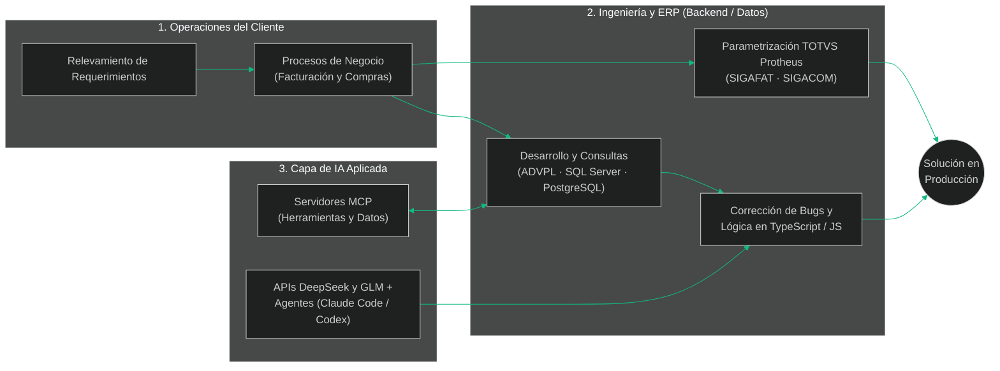

<div align="center">

  <!-- Cabecera animada (ajustada a width=850 para evitar cortes de texto) -->
  

  <h3>Consultor TOTVS Protheus (ADVPL · SQL) | Estudiante de Ingeniería de Sistemas | Backend e IA Aplicada</h3>
  <p>📍 Santa Cruz de la Sierra, Bolivia • 🎯 Rumbo a <b>Forward Deployed Engineer (FDE)</b> & <b>Backend Developer</b> (abierto a Full Stack)</p>

  <!-- Botones de contacto y estado actual -->
  <p>
    <a href="[https://www.linkedin.com/in/mario-pereyra-justiniano-86b205304](https://www.linkedin.com/in/mario-pereyra-justiniano-86b205304)" target="_blank">
      
    </a>
    <a href="mailto:mario1w3p.j@gmail.com">
      
    </a>
    
    
  </p>
</div>

<br/>

<!-- ================= BENTO GRID: LOS 3 PILARES ================= -->
<h2 align="center">⚡ Pilares de Ingeniería: Negocio + Código + IA Aplicada</h2>

<table width="100%">
  <tr>
    <td width="33%" valign="top">
      <h3 align="center">🏢 1. Negocio + ERP en Producción</h3>
      <p align="center">
        
      </p>
      <ul>
        <li><b>Despliegue con clientes reales:</b> 1 año como Consultor en <b>Resultar Soluciones SRL</b> implementando el ERP TOTVS Protheus en empresas de Bolivia y del exterior.</li>
        <li><b>Traducción operativa:</b> Relevamiento directo con el cliente y conversión de procesos de <b>Facturación</b> y <b>Compras</b> a parametrización del sistema.</li>
        <li><b>Crecimiento proyectado:</b> Facturación electrónica del SIN (<b>SIAT</b>).</li>
      </ul>
    </td>
    <td width="33%" valign="top">
      <h3 align="center">⚙️ 2. Backend & Datos</h3>
      <p align="center">
        
      </p>
      <ul>
        <li><b>Lógica empresarial:</b> Desarrollo en <b>ADVPL</b> y consultas avanzadas sobre <b>SQL Server</b> y <b>PostgreSQL</b>.</li>
        <li><b>Resolución en caliente:</b> Diagnóstico y corrección de errores y bugs del sistema junto a consultores senior.</li>
        <li><b>Desarrollo Web:</b> Construcción de aplicaciones y herramientas con <b>TypeScript</b>, <b>JavaScript</b>, <b>HTML</b> y <b>CSS</b>.</li>
      </ul>
    </td>
    <td width="33%" valign="top">
      <h3 align="center">🤖 3. IA Aplicada & Agentes</h3>
      <p align="center">
        
      </p>
      <ul>
        <li><b>Servidores MCP:</b> Desarrollo de servidores <i>Model Context Protocol</i> que conectan agentes de IA con herramientas y fuentes de datos.</li>
        <li><b>Integración de LLMs:</b> Consumo e integración de APIs de <b>DeepSeek</b> y <b>GLM</b>.</li>
        <li><b>Flujo Agentic Avanzado:</b> Desarrollo asistido con <b>Claude Code</b>, <b>Codex</b>, <b>OpenCode</b> y <b>Pi agent</b>.</li>
      </ul>
    </td>
  </tr>
</table>

<br/>

<!-- ================= ARQUITECTURA MERMAID: ENFOQUE FDE ================= -->
<h2 align="center">🔄 Arquitectura de Trabajo — Por qué encajo como Forward Deployed Engineer (FDE)</h2>

<p align="center">
  <i>Como consultor ya ejecuto trabajo de despliegue en terreno con el cliente; sumado a desarrollo backend e IA aplicada, cierro el ciclo completo desde el requerimiento hasta la producción:</i>
</p>



<br/>

<!-- ================= MATRIZ DE STACK TÉCNICO ================= -->
<h2 align="center">🛠️ Matriz de Stack Técnico (Clasificado por Nivel Real)</h2>

<table width="100%">
  <tr>
    <td width="50%" valign="top">
      <h3 align="center">🔥 Nivel Principal (Producción & Proyectos)</h3>
      <p align="center"><i>Demostrado en consultoría ERP (Resultar Soluciones) y proyectos personales</i></p>
      <div align="center">
        <p><b>Lenguajes Core & ERP</b></p>
        
        
        <br/><br/>
        
        <p><b>Bases de Datos Relacionales</b></p>
        
        
      </div>
    </td>
    <td width="50%" valign="top">
      <h3 align="center">🤖 Ecosistema IA & Radar de Lenguajes</h3>
      <p align="center"><i>Uso avanzado de agentes de codificación y niveles progresivos</i></p>
      <div align="center">
        <p><b>Protocolos, APIs y Agentes de IA (Nivel Avanzado)</b></p>
        
        <br/>
        
        
        
        
        
        
        <hr/>
        <p><b>Lenguajes de Uso Ocasional</b></p>
        
        <br/>
        <code>Python (Uso ocasional)</code>
        <p><b>Lenguajes en Exploración</b></p>
        
        <br/>
        <code>Rust · Go · Java (En etapa de exploración)</code>
      </div>
    </td>
  </tr>
</table>

<br/>

<!-- ================= TRAYECTORIA & TELEMETRÍA EN CONSOLA ================= -->
<h2 align="center">💼 Experiencia Laboral y Formación Académica</h2>

```diff
@@ CONSULTOR TOTVS PROTHEUS | Resultar Soluciones SRL (Oct 2025 – Presente • 1 año) @@
! Santa Cruz de la Sierra, Bolivia | Clientes en Bolivia y del exterior
+ Implementación y parametrización del ERP brasileño TOTVS Protheus en etapa de despliegue.
+ Especialización principal en el módulo de Facturación (SIGAFAT) y apoyo en Compras (SIGACOM).
+ Relevamiento de requerimientos e interacción directa con el cliente para traducir procesos de negocio al ERP.
+ Desarrollo en lenguaje ADVPL y ejecución de consultas SQL sobre SQL Server y PostgreSQL.
+ Diagnóstico, corrección de errores/bugs del sistema y soporte directo a consultores senior en proyectos activos.

@@ FORMACIÓN UNIVERSITARIA | Universidad NUR (Egreso estimado: Septiembre 2027) @@
! Carrera: Estudiante de Ingeniería de Sistemas — Cursando mediados del 7.º Semestre (Octubre 2026)
+ Idiomas: Español (Nativo) | Inglés (Básico — en plan de mejora continua para roles FDE remotos).
```

<br/>

<!-- ================= PROYECTOS EN CONSTRUCCIÓN (BENTO CARDS) ================= -->
<h2 align="center">🚀 Laboratorio de Proyectos</h2>

<table width="100%">
  <tr>
    <td width="50%" valign="top">
      <h3>🔌 Servidores MCP (Model Context Protocol)</h3>
      <p>
        
        
      </p>
      <p>Desarrollo de servidores bajo el estándar <b>Model Context Protocol (MCP)</b> diseñados para conectar agentes autónomos de IA con herramientas locales, APIs y fuentes de datos estructurados.</p>
    </td>
    <td width="50%" valign="top">
      <h3>🛍️ Plataforma Web — Venta de Carteras</h3>
      <p>
        
        
      </p>
      <p>Sitio web comercial enfocado en digitalizar el catálogo y flujo de ventas para el emprendimiento de carteras de mi madre.</p>
    </td>
  </tr>
</table>

<br/>

<!-- ================= DASHBOARD DE ESTADÍSTICAS (GHSTATS.DEV) ================= -->
<h2 align="center">📊 Telemetría de GitHub</h2>

<div align="center">
  <!-- Tarjeta principal de ghstats.dev -->
  
</div>

<br/>

<div align="center">
  <sub>⚡ <b>Disponibilidad:</b> Actualmente empleado en Resultar Soluciones SRL • Modalidad y horario a coordinar según la oferta para roles de <b>Forward Deployed Engineer (FDE)</b>, <b>Backend</b> o <b>Full Stack</b>.</sub>
</div>
