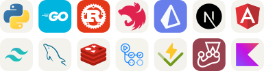

<picture>
  <source media="(prefers-color-scheme: dark)" srcset="assets/banner-oscuro.svg">
  <source media="(prefers-color-scheme: light)" srcset="assets/banner-claro.svg">
  
</picture>

## `$ whoami`

Soy Mario, desarrollador de Santa Cruz de la Sierra, Bolivia. Estudio Ingeniería de Sistemas en la Universidad NUR y voy en 7.º semestre.

Desde octubre de 2025 trabajo como consultor TOTVS Protheus en Resultar Soluciones. Me toca estar cerca del cliente: entender cómo trabaja su empresa, configurar el ERP y programar en AdvPL y SQL lo que el sistema no trae de fábrica. En este tiempo hice desarrollos para 4 empresas cliente y participé en una salida en vivo. Esa parte me gusta mucho: entender la lógica de negocio que hay detrás de cada proceso.

## `$ cat aprendiendo.md`

Hoy estoy enfocado en la ingeniería de IA. Lo que más me interesa:

- **Ingeniería de contexto y de harness:** cómo darle a un agente lo que necesita para trabajar bien. Ahora estoy aprendiendo a llevar un harness al proceso de una empresa cliente.
- **Ingeniería de agentes:** guardrails, y cómo probar a los agentes para saber si de verdad hacen lo que deben.
- **Dirigir agentes con buenas prácticas:** patrones de arquitectura y de diseño, fundamentos de ingeniería de software y las convenciones de cada lenguaje: TypeScript, JavaScript, Python, Rust y Go.
- **Usar agentes para aprender,** y seguir aprendiendo.

También me gusta construir herramientas: servidores MCP y APIs.

## `$ echo $RUMBO`

Quiero crecer hacia backend y *Forward Deployed Engineering*: trabajar cerca del cliente y construir el software que resuelve su problema. Me interesa aprender en equipos que cuiden las buenas prácticas, las convenciones y los estándares.

## `$ ls ~/proyectos`

- **[Vintage Secret's](https://github.com/Mario-pereyra/vintage)**: catálogo e inventario para el emprendimiento de mi familia. Está en producción: [verlo](https://vintage.marioelprogamer710.workers.dev).
- **protheus-db-mcp**: servidor MCP para que los agentes de IA consulten bases de Protheus sin poder escribir en ellas. Código privado.
- **[Quiniela Mundial 2026](https://quinela-mundialera-frontend.vercel.app)**: pronósticos del Mundial, proyecto universitario en equipo.
- **[Cine Reservas](https://github.com/Mario-pereyra/practico4)**: reserva de asientos de cine, proyecto universitario.
- **[Impulsame](https://github.com/Mario-pereyra/Proyecto_Final_Web_02-2025)**: plataforma de crowdfunding, proyecto universitario.

## `$ cat stack.yaml`

<table>
  <tr>
    <td width="50%" valign="top">
      <code>├─ ya_manejo:</code>  
      <picture>
        <source media="(prefers-color-scheme: dark)" srcset="assets/stack/diario-oscuro.svg">
        <source media="(prefers-color-scheme: light)" srcset="assets/stack/diario-claro.svg">
        
      </picture> 
      Y también AdvPL, SQL Server, TOTVS Protheus, servidores MCP y agentes de codificación: Claude Code, Codex, OpenCode y Pi agent.
    </td>
    <td width="50%" valign="top">
      <code>╰─ estoy_aprendiendo:</code>  
      <picture>
        <source media="(prefers-color-scheme: dark)" srcset="assets/stack/aprendiendo-oscuro.svg">
        <source media="(prefers-color-scheme: light)" srcset="assets/stack/aprendiendo-claro.svg">
        
      </picture> 
      Python, Go, Rust, NestJS, Prisma, Next.js, Angular, Tailwind, MySQL, Redis, GitHub Actions, Vitest, Jest y Kotlin.
    </td>
  </tr>
</table>

## `$ connect`

&nbsp;
&nbsp;
&nbsp;

 

Escrito desde Santa Cruz de la Sierra, Bolivia, con ayuda de mis agentes.
